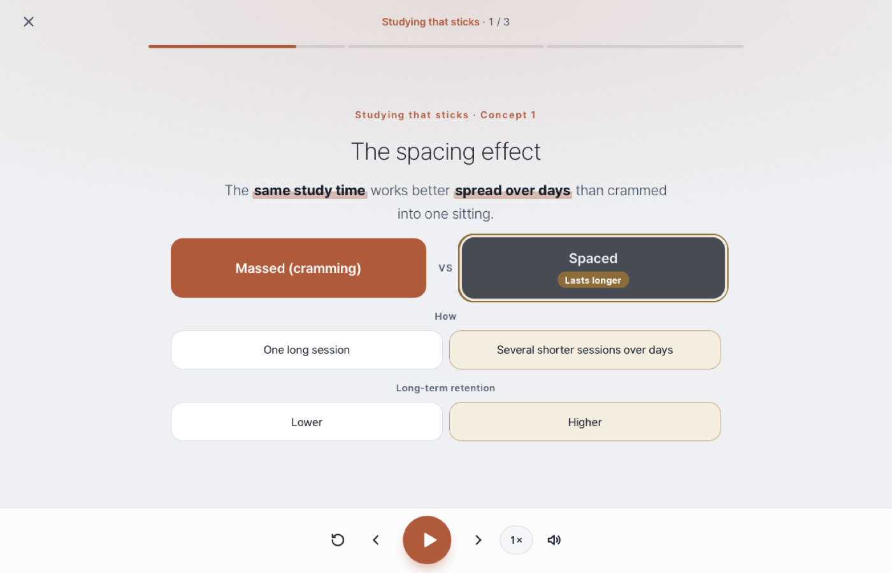
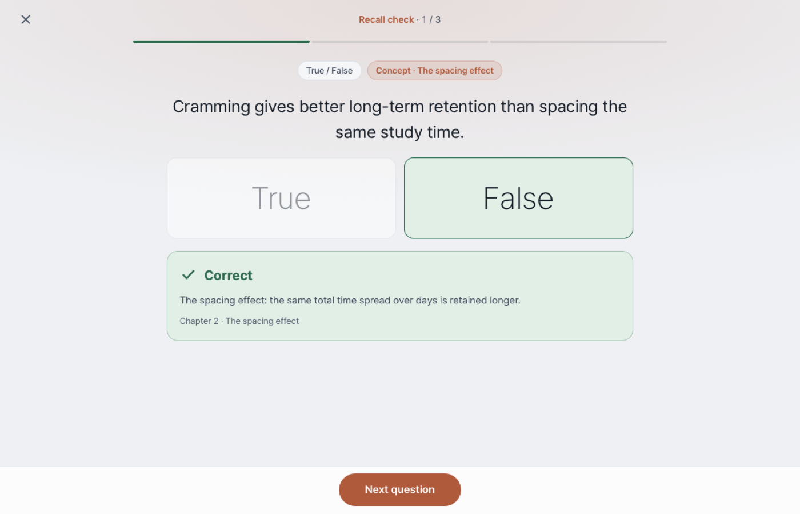

# ConceptCast

**Press play, watch, remember.** ConceptCast turns study material (lecture notes, PDFs, slides)
into a narrated, auto-playing lesson app. Each concept gets its own scene, built up piece by piece
with diagrams while a natural voice reads along. Each chapter ends with a recall quiz that replays
only what you missed.

It is packaged as a [Claude](https://claude.com/claude-code) skill: you hand Claude your notes, and
it follows a tested method to build, voice and verify the app. It works for any subject and any
language.

<p align="center">
  
  
</p>

Try it: download [`examples/memory-basics/memory-basics.html`](examples/memory-basics/memory-basics.html)
and open it in a browser. It is a six-concept sample course with a neural voice built in.

## Why it works

ConceptCast was built for a student who was too exhausted to study the night before an exam.
Every choice serves a learner with almost no attention left:

- **One idea per screen,** built up beat by beat: title → one-line idea → diagram items →
  memory hook → exact answer terms → example. The current item is highlighted and spoken.
- **No clicks until the quiz.** Press play once; it advances by itself.
- **The diagram fits the idea:** comparisons, processes, branches, bar charts, definitions,
  warnings. There are 15 diagram types.
- **Exact wording.** Definitions and answer terms are copied from the notes, because exams grade
  wording.
- **Recall, then targeted replay.** One question per concept after each chapter. Missed concepts
  replay, then the exact missed questions are asked again.
- **Never silent, never stuck.** Recorded voice → browser voice → reading timer.
- **One file.** The whole app, audio included, is a single HTML file you can double-click, move,
  or send.

## The method


The full method, and the reasons behind each step, is in
[`references/method.md`](references/method.md). In short:

1. **Ask first:** scope, language, the learner's device, and which voice.
2. **Ingest** the notes into Markdown, the single source of truth.
3. **Write a question bank** in the notes' exact wording.
4. **Write concept cards.** Gate A: an independent review for accuracy and coverage.
5. **Generate the narration** and review every line.
6. **Voice:** audition voices, record, trim, check every clip. Gate B: the learner approves a sample.
7. **Build** one HTML file.
8. **Verify like the learner:** test every beat and every question in their browser engine, then
   an independent attempt to break it. Gate C.

## Install as a Claude skill

```bash
git clone https://github.com/WeldingArc/conceptcast.git ~/.claude/skills/conceptcast
```

Then ask Claude something like *"Make a ConceptCast from the lecture PDFs in ~/Downloads/Biology"*.
The skill starts by asking about scope, language, device and voice.

Update later with `git -C ~/.claude/skills/conceptcast pull`.

## Use it by hand

Requirements:

- Python 3.9+
- `ffmpeg`
- [`uv`](https://docs.astral.sh/uv/), for the Microsoft voices
- optional: Node (template syntax check)
- optional: macOS with Swift (Safari-engine tests)

```bash
python3 scripts/build.py examples/memory-basics/course.json        # app + narration script + lines to record
uv run --with edge-tts python scripts/tts_render.py examples/memory-basics --audition   # hear candidate voices
uv run --with edge-tts python scripts/tts_render.py examples/memory-basics              # record every line
python3 scripts/tts_trim.py examples/memory-basics                 # trim silence, prove no speech was cut
python3 scripts/tts_check.py examples/memory-basics                # rate, loudness, gaps for every clip
python3 scripts/build.py examples/memory-basics/course.json        # rebuild with the clips embedded
swift scripts/webkit_test.swift examples/memory-basics/memory-basics.html   # silent Safari-engine test
```

The course format is in [`references/course-schema.md`](references/course-schema.md). Diagram
types are in [`references/visual-types.md`](references/visual-types.md).

## Voices

| Option | Notes |
|---|---|
| Microsoft neural (edge-tts) | Free, no key, very natural, many languages. Default. Tested |
| Gemini TTS, OpenAI TTS, ElevenLabs | API key; expressive. Written from the API docs; run the audition step first |
| Local open-source (Piper, Kokoro, MeloTTS, Qwen3-TTS, …) | Offline and private, through a generic command wrapper |
| macOS voices | Offline; download "Premium" voices for better quality. Tested |
| Browser voice | Nothing to record; robotic, but always available |

Details and setup: [`references/tts-options.md`](references/tts-options.md).

## Languages

The player and narration ship with English and Korean language packs. To add a language, copy
the `en` entries in [`scripts/langpacks.py`](scripts/langpacks.py) and translate about 80 short
strings. Any string can also be overridden per course.

## Repository layout

```
SKILL.md                 instructions Claude follows
assets/player.html       the app template
scripts/                 build, voice (render, trim, check), Safari-engine test
references/              method, schema, diagram types, narration, voices, verification prompts
diagram/pipeline.svg     the method on one page
examples/memory-basics/  a sample course and its built app
```

## License

MIT. See [LICENSE](LICENSE).
