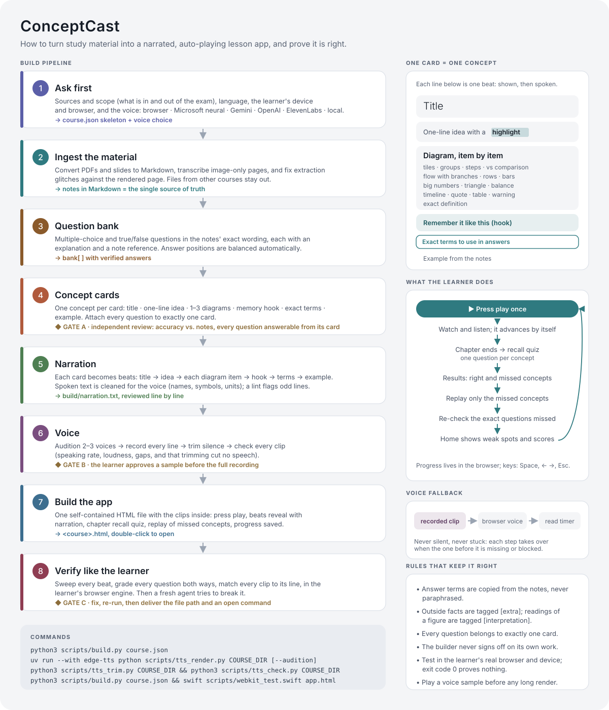
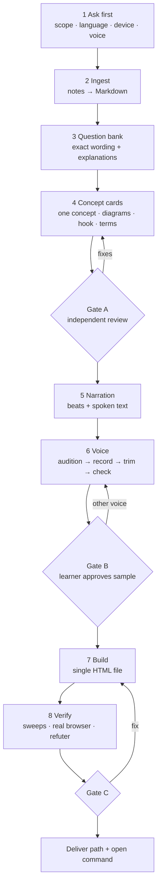

# The ConceptCast method

ConceptCast came out of one night: a student, exhausted the day before an exam, said they could
not concentrate and wanted to be "spoon-fed" the material. They wanted to press play and absorb
it. The result worked so well that they asked for the method to be written down for every future
subject. This document is that method: what to build, and why each part exists.

## Who it is for

Learners with little attention or motivation left: tired, anxious, ADHD, or simply cramming.
Design for the moment the learner wants to stop. Every screen must be worth less effort than
closing the app.

## Principles

1. **One idea per screen.** A scene holds exactly one concept. The header shrinks once the diagram
   starts, so the eye has one place to go.
2. **Build it up, don't dump it.** Each concept unfolds in beats:
   title → one-line idea → diagram, item by item → memory hook → exact terms → example.
   The current item is highlighted and earlier ones dim; what you look at is what you hear.
3. **Show the shape of the idea.** A comparison is two columns, a process is arrows, a list of
   reasons is numbered steps, a quantity is a bar. The diagram type is chosen from the idea's
   structure, not for decoration (`visual-types.md`).
4. **Say it, don't make them read it.** Every beat is narrated. Reading is optional; listening is
   enough. The voice has to sound human; a robotic voice was the first complaint.
5. **No clicks until the quiz.** After pressing play, everything advances on its own. Controls
   exist (pause, back, next, speed), but nothing requires them.
6. **Exact terms, every time.** Exams grade wording. Definitions on screen are copied from the
   notes, the "terms" beat lists the words to write, and nothing is paraphrased in a way that
   would cost a point.
7. **Test, then replay only what was missed.** Each chapter ends with a recall quiz, one question
   per concept. Missed concepts replay in a short playlist, then the exact missed questions are
   asked again. Retrieval practice and spacing do the remembering; the player just makes them
   effortless.
8. **Never stall, never go silent.** Audio falls back from recorded clip to browser voice to a
   reading timer. A blocked or missing clip costs one line of robotic voice, never a frozen screen.
9. **Prove it before claiming it.** Content is reviewed against the notes by someone other than the
   author. The finished file is tested where the learner will use it: their browser engine, their
   device. Then someone other than the builder tries to break it.

## The pipeline

| # | Phase | Output | Gate |
|---|---|---|---|
| 1 | Ask first: material and scope, language, device and browser, voice | course skeleton, voice choice | — |
| 2 | Ingest: convert to Markdown, transcribe images, fix extraction errors | notes = source of truth | — |
| 3 | Question bank in the notes' wording, with explanations and references | `bank[]` | — |
| 4 | Concept cards: one concept each, 1–3 diagrams, hook, exact terms, example, questions attached | `chapters[].cards[]` | **A:** independent accuracy and coverage review |
| 5 | Narration: beats generated, cleaned for speech, reviewed line by line | `build/narration.txt` | — |
| 6 | Voice: audition, record all, trim, check every clip | `voice/clips/*.mp3` | **B:** learner approves a sample first |
| 7 | Build one self-contained HTML file | `<id>.html` | — |
| 8 | Verify like the learner: mechanical sweeps, real browser, independent refuter | test report | **C:** fix, re-run, deliver |

## Phase notes and the lessons behind them

**Ask first.** Scope errors are the most expensive. In the first build, slides from a different
class had been converted alongside the right notes. Ask which files belong, which sections are
excluded, and how the exam is weighted. Ask about the device: "Mac only" changed what had to be
tested.

**Ingest.** PDF extraction lies quietly: doubled glyphs, tables flattened out of order, text
inside images missing. Compare doubtful passages with the rendered page. Transcribe image-only
pages, and mark translations you add as translations.

**Question bank.** Write questions before cards. They define what "knowing the concept" means,
and later they audit the cards: if a card cannot answer its own questions, the card is
incomplete. Avoid referring to option numbers in explanations, because options are shuffled to
balance answer positions.

**Concept cards.** The independent review is not optional. On the first course it found:

- one outright error (a comparison against the wrong concept);
- a wrongly paired example;
- two claims the notes did not make;
- ~30 definitions shortened away from the notes' exact wording;
- seven quiz facts that no card taught.

Ask the reviewer for JSON with a confidence score per item and a needs-review list, and tell them
why accuracy matters ("this goes straight into an exhausted student's head").

**Narration.** Generated lines read badly in predictable ways:

- symbols spoken literally (`>`, `→`, `+`);
- English names read with the target language's phonetics;
- parentheses glued to grammatical particles;
- units ("450V") and abbreviations ("IV", "UCS").

The build lints for these. Read the whole script anyway; it takes ten minutes and the learner
will hear every line.

**Voice.** Always audition before a long recording. Three samples of the same sentence take
thirty seconds to make and decide the whole experience. Record each line once, keyed by a hash of
voice and text, so later edits re-record only what changed. Trim the silence engines add
(~0.2 s before, ~0.6 s after each clip); on the first course that saved six minutes of dead air.
Check every clip, not a sample.

**Build.** One file, no folder of assets, so it survives being moved, emailed, or double-clicked
from Downloads. Clips are embedded as base64 MP3. A file of about 25 MB opens in a quarter of a
second on a laptop.

**Verify.** Test in the learner's actual engine. Safari behaves differently from Chrome:

- it drops speech spoken right after a cancel;
- it pauses CSS transitions in hidden windows;
- it enforces click-to-play for audio.

A test window that is hidden slows every timer; trust event timestamps, not sampling. Then hand
the build to a fresh agent whose only job is to refute "it works". On the first course that agent
found:

- a saved setting that would have silently kept the robotic voice;
- a stray "V" read as a letter;
- a keyboard focus bug.

The builder had tested past all three.

## Adapting to a new subject or language

- **Subject.** Nothing in the player is subject-specific. Courses differ only in their cards.
  Math and science work well with `steps`, `flow`, `table` and `def`; history with `timeline`
  and `quote`; languages with `tiles`, `table` and `vs`.
- **Language.** Add a language pack in `scripts/langpacks.py`: UI strings, narration phrases,
  spoken symbols. For scripts that don't use Latin letters, add the language code to `NON_LATIN`.
  Its grammar rules (like Korean particles) go in `build.py` only if generated sentences need them.
  Otherwise, write overrides.
- **Learner.** For a stronger learner, use fewer beats per card, faster default speed and
  harder questions. For a weaker one, use more `warn` beats on classic confusions and more
  concrete examples.
